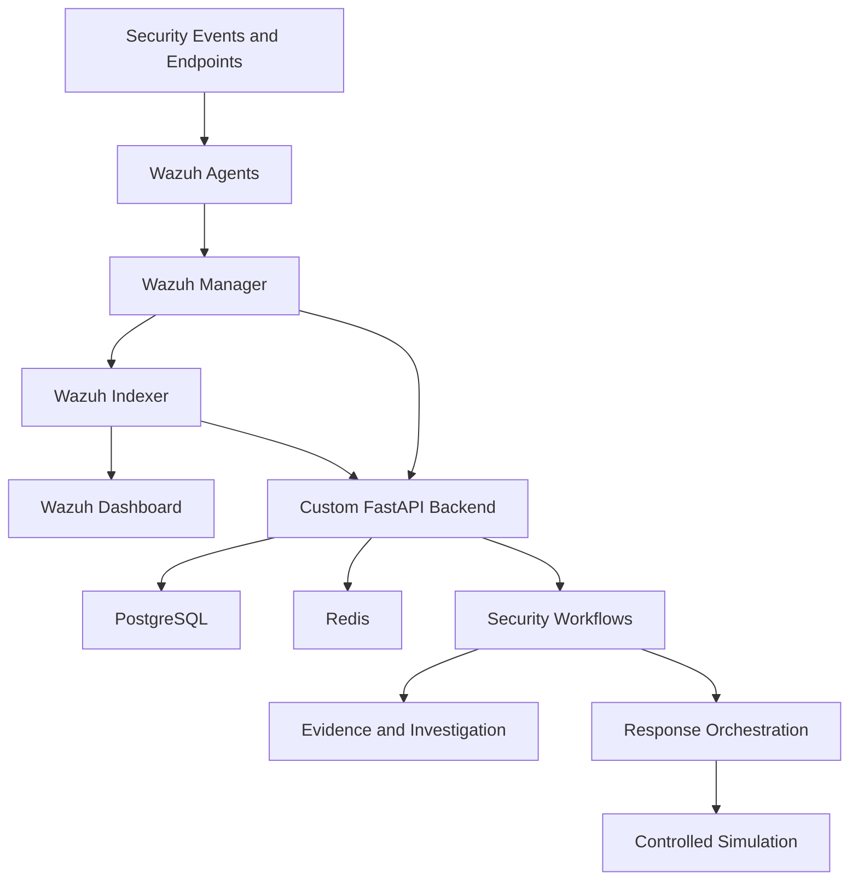

# Advanced Wazuh SOC/XDR Platform

### An Integrated Security Operations Center (SOC) and Extended Detection and Response (XDR) Platform

[](https://wazuh.com/)
[](https://fastapi.tiangolo.com/)
[](https://www.postgresql.org/)
[](https://redis.io/)
[](https://www.kali.org/)
[]()

---

## Overview

The **Advanced Wazuh SOC/XDR Platform** is a security operations and incident response project designed to extend the capabilities of a native Wazuh deployment through a custom backend and modular security workflows.

The platform combines Wazuh's security monitoring capabilities with a custom **FastAPI, PostgreSQL, and Redis architecture** to support security event management, investigation workflows, evidence handling, and controlled response orchestration.

The project follows a phased development approach, prioritizing modularity, auditability, security, and operational reliability.

Rather than replacing Wazuh's native components, the platform builds on top of them to explore how a more integrated SOC/XDR environment can be designed and implemented.

## Project Objectives

- Extend native Wazuh capabilities through a custom backend.
- Build modular workflows for security operations and incident investigation.
- Support structured evidence handling and integrity verification.
- Develop a controlled response orchestration framework.
- Enforce authentication, authorization, and auditability.
- Maintain clear separation between detection, decision-making, and response execution.
- Apply secure engineering principles throughout the development lifecycle.

## Architecture

The platform uses a native Wazuh deployment supported by custom application services.



### Core Components

| Component | Responsibility |
|---|---|
| Wazuh Manager | Security event analysis, alert generation, and agent management |
| Wazuh Indexer | Storage and indexing of security data |
| Wazuh Dashboard | Security monitoring and visualization |
| FastAPI | Custom backend APIs and application logic |
| PostgreSQL | Persistent application data and structured records |
| Redis | Supporting infrastructure for application workflows |
| Response Orchestration | Controlled, policy-driven response workflow development |

**Deployment approach:** Native installation on Kali Linux. Docker-based migration was discontinued due to environment and connectivity constraints.

## Technology Stack

| Category | Technology |
|---|---|
| Security Platform | Wazuh 4.14.7 |
| Operating System | Kali Linux |
| Backend | Python, FastAPI |
| Database | PostgreSQL |
| Supporting Infrastructure | Redis |
| API Framework | REST |
| Database Migrations | Alembic |
| Testing | Pytest |
| Version Control | Git and GitHub |

## Development Progress

The project is developed in phases to maintain a stable foundation while introducing new functionality incrementally.

| Phase | Status |
|---|---|
| Phases 0–6 | Completed and frozen |
| Phase 7 | Completed and frozen |
| Phase 8 – Stage 1: Dry-Run Foundation | Implemented; targeted tests reported passing |
| Phase 8 – Stage 2: Response Orchestration | Under development |

### Phase 8: Response Orchestration

The current development focus is a controlled response workflow with an emphasis on safety and accountability.

The Stage 2 design includes:

- Structured response request management.
- Evidence snapshot integration.
- Policy-based approval.
- Durable dispatch intent.
- Dry-run simulation.
- Execution attempt tracking.
- Cancellation handling.
- Audit event recording.
- Ownership and authorization enforcement.

**Safety boundary:** Stage 2 is limited to simulation. Real external response actions and arbitrary command execution are out of scope.

## Security Design Principles

Security is a core design requirement rather than an afterthought.

- **Least privilege:** Access to protected operations must be restricted to authorized identities.
- **Human oversight:** Disruptive response actions require appropriate approval.
- **Dry-run by default:** Simulation is used to validate workflows without executing real response actions.
- **Finite action catalog:** Only explicitly defined actions are permitted.
- **Durable intent:** Dispatch intent must be persisted before an adapter is invoked.
- **No implicit retries:** Ambiguous outcomes must not trigger blind re-execution.
- **Auditability:** Important state transitions are recorded with their corresponding audit events.
- **Evidence integrity:** SHA-256 hashing is used to detect evidence modification.
- **Concurrency safety:** Database transactions and locking protect state transitions.
- **Phase isolation:** New development must not regress the frozen baseline.

The application audit design is append-only by application behavior; it is not represented as database-level WORM storage.

## Testing and Quality Assurance

Testing is performed incrementally as new components are introduced.

The project uses Pytest for unit and integration testing, with PostgreSQL-backed tests required for database-specific guarantees such as locking, uniqueness constraints, and transaction behavior.

Reported baseline results:

| Test Suite | Result |
|---|---|
| Phase 7 tests | 18 passed |
| Full baseline suite | 261 passed, 2 skipped |
| Phase 8 Stage 1 targeted tests | 27 passed |

These results refer to previously reported test runs and do not imply that the in-progress Stage 2 implementation has been completed or validated.

## Repository Structure

The repository is organized around the existing backend, database migrations, tests, and project documentation.

```text
Advanced-Wazuh-SOC-XDR-Platform/
├── backend/
│   ├── app/
│   │   ├── api/
│   │   ├── models/
│   │   ├── response/
│   │   ├── config.py
│   │   └── router/
│   └── alembic/
├── tests/
├── docs/
│   └── PHASE_8_IMPLEMENTATION_PLAN_REV2.md
└── README.md
```

*Note: This is a high-level structural overview. The exact directory layout may evolve as implementation progresses.*

## Getting Started

### Prerequisites

- Kali Linux or a compatible Linux environment.
- Wazuh 4.14.7.
- Python 3.
- PostgreSQL.
- Redis.
- Git.

### Clone the Repository

```bash
git clone https://github.com/tejaswipandey3931l-coder/Advanced-Wazuh-SOC-XDR-Platform.git

cd Advanced-Wazuh-SOC-XDR-Platform
```

### Review the Project Documentation

Before modifying the codebase, review the approved implementation plan:

```text
docs/PHASE_8_IMPLEMENTATION_PLAN_REV2.md
```

The project is developed incrementally. Follow the documented phase boundaries and avoid modifying frozen baseline components.

*Detailed installation and configuration instructions will be added as the deployment workflow is finalized.*

## Roadmap

- [x] Establish the native Wazuh SOC foundation.
- [x] Complete and freeze the Phase 7 baseline.
- [x] Establish the Phase 8 dry-run foundation.
- [ ] Implement Stage 2 response request persistence.
- [ ] Integrate evidence snapshots and integrity verification.
- [ ] Implement policy approval and durable dispatch.
- [ ] Implement simulation adapter and execution tracking.
- [ ] Add concurrency, authorization, and audit integration tests.
- [ ] Complete full regression and migration verification.
- [ ] Document the final deployment and operational workflows.

## Current Limitations

- Stage 2 response orchestration is under development.
- Real response execution is intentionally disabled.
- Automated reconciliation of ambiguous dispatch outcomes is not included in the current scope.
- Deployment and configuration documentation is still evolving.

## Contributing

This project is under active development. Contributions and technical feedback are welcome, particularly in the areas of:

- Security architecture.
- SOC automation.
- Detection engineering.
- Incident response workflows.
- Backend reliability.
- Database integrity.
- Testing and documentation.

Please discuss significant architectural changes before implementing them, especially changes affecting the frozen baseline or approved implementation plan.

## Disclaimer

This project is intended for educational, research, and authorized security operations purposes.

It is not a replacement for a properly configured production security monitoring and incident response environment. Always test changes in an isolated environment and obtain appropriate authorization before interacting with real systems.

## Author

**Tejaswi Pandey**

Cybersecurity | SOC Operations | Security Engineering | XDR

GitHub: [@tejaswipandey3931l-coder](https://github.com/tejaswipandey3931l-coder)

---

*Built to explore the engineering principles behind a modular, auditable, and security-focused SOC/XDR platform.*
